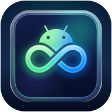

# Droid Link for Android

The official Android companion app for **Droid Link**, connecting your Android handset seamlessly to [Droid Link for macOS](https://github.com/Eckobrew/DroidLink-macOS).

<p align="center">
  
</p>

## Features

- **Secure Pairing**: Quick QR code scan over local Wi-Fi with ephemeral Curve25519 key exchange and AES-GCM encryption.
- **Failover & Reconnect**: Automatic background reconnect and encrypted Bluetooth LE fallback.
- **Messages & MMS/RCS Previews**: Real-time SMS synchronization, direct sending callbacks, and photo preview transfer.
- **Phone Calls**: Native `InCallService` integration for telecom call monitoring, remote dialing, answer/reject, and DTMF controls.
- **Notifications & Replies**: Intercept incoming notifications with live reply actions forwarded from macOS.
- **Persistent Connection Status**: Low-overhead foreground service maintaining device awareness and connection indicators.
- **Adaptive & Material You Theming**: Full adaptive launcher icons and monochrome themed icon support for Android 13+.

## Requirements

- Android 12+ (API 31+)
- Android SDK 35
- JDK 21
- Paired with [Droid Link for macOS](https://github.com/Eckobrew/DroidLink-macOS)

## Building from Source

```bash
# Run unit tests
./gradlew testDebugUnitTest

# Assemble Debug APK
./gradlew assembleDebug

# Run Lint checks
./gradlew lintDebug
```

The compiled APK will be located at:
`app/build/outputs/apk/debug/app-debug.apk`

## License

This project is licensed under the Apache 2.0 License or corresponding open-source subcomponent licenses.
